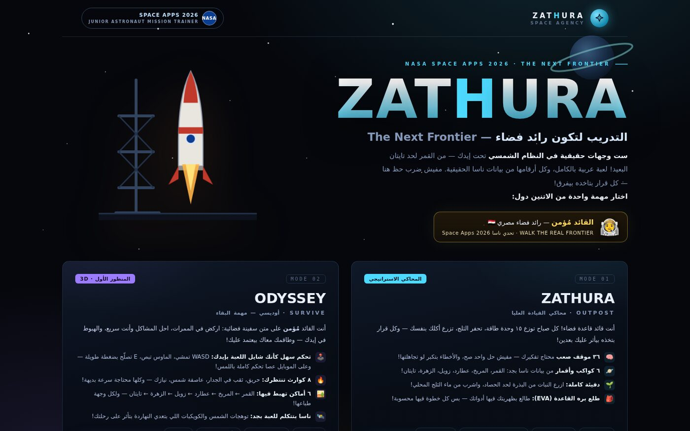
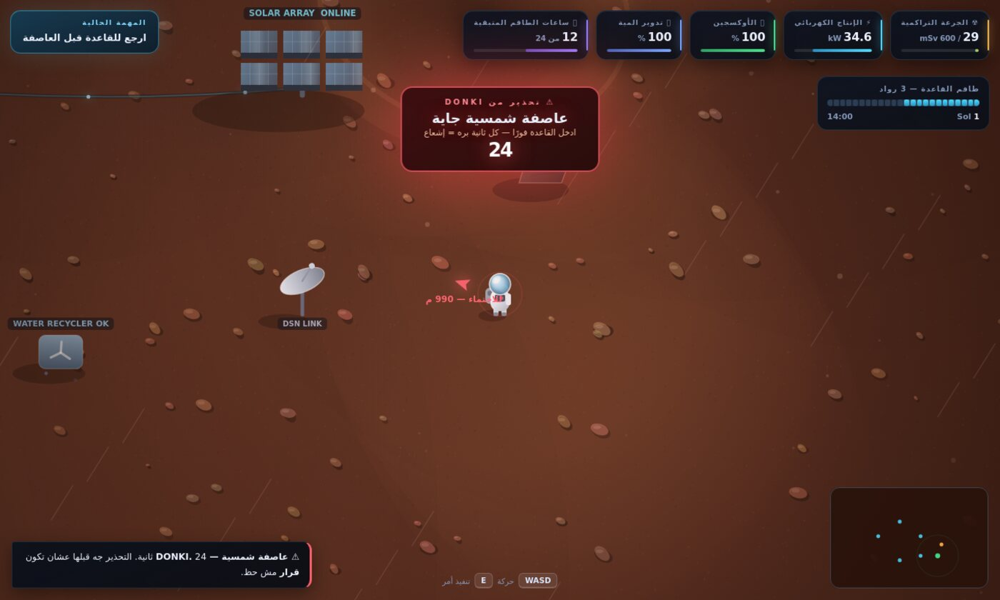
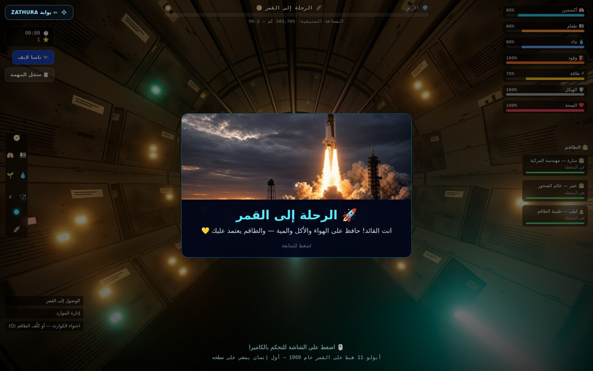

<div align="center">


# ZATHURA

**مدرّب مهمّات رائد الفضاء — Junior Astronaut Mission Trainer**

لعبة محاكاة فضائية تعليمية في المتصفح · للأعمار ٧–١٢ · بيانات NASA حقيقية · بدون تثبيت وبدون إنترنت

[](LICENSE)
[](package.json)
[](#-التشغيل)
[](package.json)
[](https://www.spaceappschallenge.org/)

[**▶ العب الآن**](play/) · [**صفحة المشروع**](index.html) · [**العرض (PPTX)**](docs/ZATHURA-pitch-ar.pptx) · [**دليل المحكّمين**](docs/JUDGES.md) · [**المرجع العلمي (PDF)**](docs/science-reference-15-scenarios-ar.pdf) · [**تدقيق المصادر**](SOURCES-AUDIT.md) · [**ملاحظات التصميم**](DESIGN.md)

<sub>العربية ↓ · [English ↓](#-english)</sub>

</div>



<table>
<tr>
<td width="50%"></td>
<td width="50%"></td>
</tr>
<tr>
<td><sub><b>MODE 01 · Outpost</b> — قاعدة + EVA على Canvas 2D</sub></td>
<td><sub><b>MODE 02 · Odyssey</b> — منظور أول 3D (React + Three.js)</sub></td>
</tr>
</table>

---

## العربية

### الفكرة في سطر

كل ألعاب الفضاء تعطي الطفل أوكسجينًا إضافيًا حين يفشل. **ZATHURA لا تفعل.**
الـSol = ٢٤ ساعة طاقم، حفر عينة = ٨ ساعات، تحليلها = ٤، تنظيف الألواح = ٤.
لا يمكنك فعل كل شيء — **وهذه هي الرسالة**: استكشاف الفضاء سلسلة مقايضات مدروسة، لا وهم قدرة مطلقة.

### ما الذي يجعلها مختلفة

| | |
|---|---|
| ⏱️ **الوقت هو المورد** | ساعات الطاقم هي العملة الوحيدة التي لا تُشترى. المهمة تتوالى تلقائيًا بمجرد بدء اليوم — لا زر «نفّذ اليوم». |
| ☢️ **الجرعة لا تُرجَع** | سقف مهني ٦٠٠ mSv. الملجأ −٨٥٪، الدروع النشطة −٣٨٪، وكل خروج EVA يضيف جرعة فورية. الوصول للسقف = إلغاء المهمة. |
| ☀️ **دورة ليل/نهار** | الألواح صفر ليلًا، ومفاعل RTG بقدرة ١٤ kW يغطي الحد الأدنى فقط. أي عجز ⇒ O₂ ×1.5 وماء ×1.4 حتى الفجر. |
| 🧪 **ISRU لا توفير فقط** | ثلج ← ماء وأكسجين، ريجوليث ← درع محلي. ست مهام ISRU مطلوبة قبل فتح زر الإقلاع. |
| 🎛️ **ميكانيكا باليد** | تمشي إلى الموقع، تقف عليه، وتضغط مطوّلًا (حفر، ريّ، صهر، إصلاح تسريب). لا أزرار «اجمع علطول». |
| 🛰️ **محرّك أحداث متكيّف** | ٢٧ سيناريو على ١٥ نوع مشهد، موزونة على قراراتك السابقة، وبتفسير «ليه» بعد كل قرار. |
| 💾 **حفظ تلقائي واستئناف** | بعد كل حدث: المهمة، الموارد، العينات، ISRU، المهام. ارجع تلاقي «استئناف مهمتك · SOL N». |

### الست وجهات

| # | الوجهة | المركبة (خيالية) | المرجع التاريخي | التحدّي الرئيسي |
|---|---|---|---|---|
| 01 | القمر | Eagle II | Apollo 11 / LM Eagle | ليل ١٤ يومًا، إشعاع، غبار حاد |
| 02 | المريخ | Ares VII | Mars 2020 / Perseverance | عواصف ترابية، ضغط منخفض، تأخير اتصال |
| 03 | عطارد | Hermes II | MESSENGER | فرق حراري ٦٠٠°، إشعاع شمسي |
| 04 | الزهرة | Aerostat V | Magellan | **منصّة عائمة ٥٠ كم** — السطح مستحيل |
| 05 | زحل | Cassini II | Cassini–Huygens | **محطة مدارية** + تايتان، حلقات، عزلة |
| 06 | **كوكب زويل** | Zewail II | وجهة خيالية تكريمًا لأحمد زويل | **جليد مالح شبه-سطحي، برد ليلي −148°** |

### الأرقام ومصادرها

كل ثابت إما رقم NASA منشور أو **تقدير لعبة مكتوب صراحةً** — واللعبة تُصنّف أيهما في الـHUD وفي تقرير النتيجة.

| الكمية | القيمة | النوع |
|---|---|---|
| أكسجين للرائد يوميًا | `0.84 kg` | NASA (ECLSS) |
| غذاء جاف للرائد يوميًا | `1.56 kg` | BVAD 2022 |
| ماء شرب للرائد يوميًا | `3.20 kg` | BVAD 2022 |
| استرجاع الماء | `90% → 98%` | NASA (Brine Processor) |
| سقف الجرعة المهنية | `600 mSv` | NASA STD-3001 |
| جرعة سطح المريخ | `0.64 mSv/day` | RAD / MSL |
| جرعة العبور | `1.84 mSv/day` | RAD / MSL |
| تخفيض الملجأ / الدروع النشطة | `−85% / −38%` | تقدير اللعبة |

**مرجع الطقس الفضائي:** أرشيف DONKI لمايو ٢٠٢٤ (أقوى عاصفة في ٢٥ سنة) محفوظ في [`data/donki/`](data/donki/):
`CME 85 · FLR 135 (منها 17 من فئة X) · GST 4 (Kp 9.0) · SEP 14`.
اللعبة تختار العاصفة من **SEP** — لأن الجزيئات الشمسية عالية الطاقة هي ما يضرب الروّاد فعلًا، لا التوهجات.

> ⚠️ **أمانة علمية:** الأرقام محاكاة تعليمية مبنية على قيم منشورة وليست قياسات حيّة.
> وحدة RadLab غير موثّقة علنًا، ومصادر DONKI بجودة «prototyping» وليست تنبؤات رسمية (المرجع NOAA SWPC).

### للمحكّمين — أين الدليل

| المعيار | الدليل داخل المستودع |
|---|---|
| **Impact** | عربي أولًا ٧–١٢ · أوفلاين · بلا تثبيت — [صفحة المشروع](index.html#judging) |
| **Creativity** | الوقت هو العملة + محرّك أحداث متكيّف + وضعان على نفس الثوابت |
| **Validity** | ٢٢ مصدرًا منسوبًا · كل ثابت مُصنَّف — [SOURCES-AUDIT](SOURCES-AUDIT.md) |
| **Relevance** | Artemis وبقاء الطاقم وISRU كميكانيكا أساسية |
| **Presentation** | حزمة أوفلاين + صفحة ثنائية اللغة + عرض ١٤ سلايدًا + PDF |

التفصيل الكامل (معمارية، تحقّق، حدود معروفة): [`docs/JUDGES.md`](docs/JUDGES.md)

### وضعان للعب — بوابة واحدة

| | الوضع ١ — محاكي القاعدة | الوضع ٢ — أوديسي: مهمة البقاء |
|---|---|---|
| اللعبة | ZATHURA Outpost v3.3.0 «العالم الحي» | Odyssey: Survive — من الإطلاق للهبوط |
| المنظور | إدارة موارد + EVA على Canvas 2D | منظور أول 3D داخل المركبة |
| التحكم | WASD/أسهم + E مطوّل | WASD + ماوس (Pointer Lock) + E مطوّل + لمس |
| الوجهات | ٦: القمر · المريخ · عطارد · الزهرة · زحل/تايتان · زويل | نفس الستة بنفس الصعوبة |
| الرابط | [`play/game1.html`](play/game1.html) | [`play/game2.html`](play/game2.html) |

البوابة: [`play/index.html`](play/index.html) — حزمة واحدة تُنسخ كما هي وتعمل أوفلاين.

### التشغيل

| الطريقة | الخطوات |
|---|---|
| **الأسرع** | افتح [`play/index.html`](play/index.html) واختار الوضع — أو [الوضع ١](play/game1.html) / [الوضع ٢](play/game2.html) مباشرة. |
| للتطوير | `node build.js` — يجمع `src/` في `play/game1.html` مع **إزالة أدوات الاختبار** (إعادة إنتاج مطابقة بايت ببايت). |
| أدوات QA | `node build.js --dev` — نفس البناء مع إبقاء كتل `@QA-BEGIN/@QA-END` للتطوير المحلي فقط. |
| للتحقق | `node tools/verify-build.js` — يتأكد أن `play/game1.html` مطابق لما ينتجه البناء (CI يشغّله مع كل push). |
| محليًا | `python3 -m http.server 8080` ثم افتح `http://localhost:8080`. |

### البنية

```
play/                   →  حزمة اللعب الجاهزة (تُنسخ كما هي، أوفلاين)
├─ index.html           بوابة اختيار الوضع
├─ game1.html           الوضع ١ — ناتج البناء من src/ (524 KB)
└─ game2.html           الوضع ٢ — أوديسي (1.7 MB، React + Three.js مضمّنين)

src/                    →  يُجمع في  play/game1.html
├─ missiondata.js       البيانات: 6 مهام · 36 سيناريو · 22 مصدر · ثوابت المحاكاة
├─ core.js              الحالة · الصوت (WebAudio) · الراوتر · المودالات
├─ render.js            كواكب · نجوم · رائد · جزيئات · ثيمات
├─ quests.js            محرّك «مهمتي» والتسلسل
├─ screens_*.js         intro · hq · launch · outpost · return · result
└─ styles.css

build.js                →  src/ ← play/game1.html (ملف واحد، أدوات QA مُزالة)
index.html              →  صفحة المشروع (GitHub Pages)
assets/                 →  لقطات · أيقونة · site.css · site.js
data/donki/             →  أرشيف أحداث مايو ٢٠٢٤
tools/verify-build.js   →  فحص قابلية إعادة البناء
docs/                   →  دليل المحكّمين (JUDGES) + العرض (PPTX) + المرجع العلمي (PDF)
```

كل شاشة تسجّل نفسها بـ `registerScreen(name, {mount, unmount})` والراوتر ينقل بـ `go(name)`،
وكل canvas يُدمَّر عند الخروج من الشاشة — لا تسريب ذاكرة.

### المصادر

[DONKI](https://ccmc.gsfc.nasa.gov/tools/DONKI/) · [RadLab](https://visualization.osdr.nasa.gov/radlab/) · [OSDR](https://osdr.nasa.gov/) · [NASA Open APIs](https://api.nasa.gov/) · [BVAD 2022 / NTRS](https://ntrs.nasa.gov/) · Mars Trek

تدقيق المصدر-بالمصدر (ما يعمل، CORS، وحدات القياس، والأرقام التي كانت خطأ في المسودة): [`SOURCES-AUDIT.md`](SOURCES-AUDIT.md).

### حقوق

البيانات العلمية ملك NASA وشركائها وتُنسب داخل اللعبة وفي لوحة المصادر.
الكود والرسومات منشأة خصيصًا لهذا المشروع التعليمي تحت رخصة MIT.

---

## 🇬🇧 English

### The one-line idea

Most space games hand the child extra oxygen when they fail. **ZATHURA doesn’t.**
A Sol is 24 crew-hours. Digging a sample costs 8. Analysing it costs 4. Cleaning the solar panels costs 4.
You cannot do everything — and that is the lesson: exploration is a sequence of deliberate trade-offs, not a power fantasy.

### What it is

A browser-based space base management trainer for **ages 7–12**, built for the
**NASA Space Apps Challenge 2026** (*The Next Frontier*) under the *Junior Astronaut Mission Trainer* brief.
Two playable modes (a strategic base simulator and a first-person 3D survival mission),
six destinations, 36 adaptive scenarios and 22 attributed NASA sources.
Everything runs offline from a single HTML file — no install, no accounts, no network calls.

### Why it is different

- **Time is the currency.** The clock never pauses and there is no “end day” button. Real hours: dig 8, analyse 4, repair 2.
- **Radiation dose never resets.** 600 mSv career ceiling; shelter −85%, active shielding −38%, every EVA adds an immediate hit.
- **Day/night drives the hardest decision of each Sol.** Solar output is zero at night; a 14 kW RTG covers only the minimum.
- **ISRU, not just conservation.** Ice → water + oxygen, regolith → local shielding. Six ISRU quests gate the launch button.
- **Hands-on, not menus.** You walk the base, stand on a sample site, and hold a key. Short press opens a panel; long press does the work.
- **Adaptive event engine.** Repeated bad decisions raise the odds of radiation scenarios; the game explains *why* after every outcome.
- **Autosave + real resume.** Close the tab, come back, mission control offers “resume your mission · SOL N”.

### Science

| Quantity | Value | Type |
|---|---|---|
| Oxygen per crew, per day | `0.84 kg` | NASA (ECLSS) |
| Dry food / drinking water per crew, per day | `1.56 kg` / `3.20 kg` | BVAD 2022 |
| Water recovery | `90% → 98%` | NASA (Brine Processor) |
| Career dose ceiling | `600 mSv` | NASA STD-3001 |
| Mars surface / transit dose rate | `0.64` / `1.84 mSv/day` | RAD / MSL |
| Shelter / active shielding reduction | `−85% / −38%` | Game estimate |

The space-weather reference is a cached **DONKI** archive of May 2024 — the strongest storm in 25 years
(`CME 85 · FLR 135 · GST 4 · Kp 9.0 · SEP 14`), stored in [`data/donki/`](data/donki/).
Storms are picked from **SEP** events, because solar energetic particles are what actually irradiate astronauts — not flares.

**Scientific honesty:** these figures are an educational simulation built on published values, not live telemetry.
RadLab’s unit is not publicly documented, and DONKI sources are prototyping quality — not official forecasts
(the operational reference is NOAA SWPC). The game labels every constant as *NASA* or *game estimate*.

### Run it

```bash
# fastest — just open the built file
play/index.html

# rebuild Mode 1 from src/ (QA hooks stripped, byte-for-byte reproducible)
node build.js

# local debugging build that keeps the QA hooks
node build.js --dev

# confirm the committed build matches src/
node tools/verify-build.js
```

### Structure

```
src/            ten modules + stylesheet → concatenated by build.js
play/           the shippable package: launcher + game1 (Mode 1) + game2 (Mode 2)
docs/           science reference PDF (15 scenarios, Arabic)
index.html      the project page (GitHub Pages)
assets/         screenshots, icon, project-page CSS/JS
data/donki/     cached May 2024 DONKI events
```

### Destinations

Moon (Eagle II) · Mars (Ares VII) · Mercury (Hermes II) · Venus (Aerostat V — a floating platform, the surface is impossible) ·
Saturn (Cassini II — orbital station) · **Planet Zewail** (a fictional world invented by the team in honour of Ahmed Zewail, Nobel 1999).

### Team & data

Built by the ZATHURA team for NASA Space Apps Challenge 2026 (Nov 14–15, 2026).
Scientific data belongs to NASA and its partners and is attributed in-game and in the sources panel.
Code and artwork created for this project, MIT licensed.

---

<div align="center">

**⚠️ مشروع تعليمي مستقل / Independent educational project.**
غير تابع لـ NASA ولا يمثلها · Not affiliated with, endorsed by, or representing NASA.
المركبات خيالية مستوحاة من مهام NASA التاريخية · Vehicles are fictional, inspired by historic NASA missions.

**MIT © 2026 ZATHURA Team**

</div>
